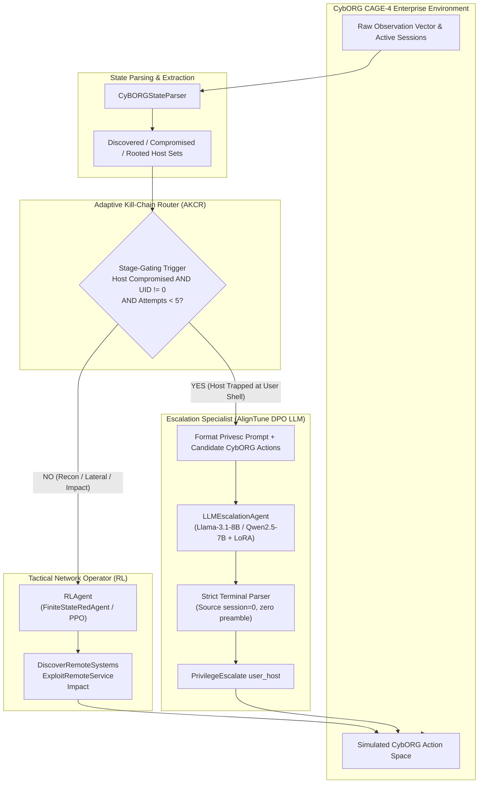

# 🎯 Adaptive Kill-Chain Router (AKCR)
### Hybrid Reinforcement Learning & AlignTune DPO for Autonomous Red-Teaming

[](https://hackathon.lexsi.ai/tracks)
[](https://github.com/Lexsi-Labs/aligntune)
[](https://github.com/cage-challenge/cage-challenge-4)
[](LICENSE)

---

## 📌 Executive Summary

Modern cybersecurity relies on autonomous defense agents (Blue Teams) to protect critical enterprise infrastructure. However, automated stress-testing tools face a fundamental dilemma:
1. **Pure Reinforcement Learning (RL)** excels at high-speed network reconnaissance and lateral movement, but consistently bottlenecks at localized **privilege escalation** ($P(\text{Root} \mid \text{Comp}) = 65.3\%$) and post-root disruption ($P(\text{Impact} \mid \text{Root}) = 61.5\%$), leaving **15.7%** end-to-end host disruption yield (`3.20` hosts/episode).
2. **Pure Large Language Models (LLMs)** possess extensive semantic knowledge of system misconfigurations, but burn massive token budgets wandering through ungrounded actions (`72,317` tokens/episode, `120.38s`/episode) and fail to sustain long-horizon tactical campaigns (`0.0%` Impact Rate).

**Adaptive Kill-Chain Router (AKCR)** solves this through an inverted, stage-gated orchestration framework evaluated across **30 distinct CybORG CAGE-4 random seeds (120-step horizons)** on **NVIDIA L4 GPUs**:
- **+24.7 pp Privilege Escalation Gain:** $P(\text{Root} \mid \text{Comp})$ jumps from `65.3%` (Pure RL) and `49.4%` (Pure LLM) to **`90.0%`** (`190/211`, $z = +6.22, p < 0.0001$).
- **+37.4 pp Operational Weaponization Gain:** $P(\text{Impact} \mid \text{Root})$ jumps from `61.5%` (Pure RL) and `0.0%` (Pure LLM) to **`98.9%`** (`188/190`, $z = +9.03, p < 0.0001$).
- **2.05× End-to-End Host Disruption Yield:** $P(\text{Impact} \mid \text{Disc})$ doubles from `15.7%` (`3.20` hosts/ep) in Pure RL to **`32.1%`** (`6.27` hosts/ep, $z = +6.70, p < 0.0001$).
- **97.0% Token Reduction & 10.1× Speedup over Pure LLM:** Routing `91.9%` of tactical steps to RL and only `8.1%` (`9.7` steps/ep) to the **AlignTune DPO** specialist cuts inference cost from `72,317` to **`2,172` tokens/ep** and wall-clock time from `120.38s` to **`11.89s`/ep**.
- **Lexsi Labs Ecosystem Integration:** Powered by **AlignTune** (4-bit NF4 LoRA DPO alignment on CybORG-native preference pairs in `src/training/train_dpo.py`), **CuratorKIT** & **SafeTune** (schema deduplication, CybORG syntax verification, and fabricated-token safety gating in `src/training/prepare_dpo_data.py`), plus full provenance/audit manifests (`provenance.json`, `dpo_curation_audit.json`, `audit_raw_llm.jsonl`).

---

## 🏛️ System Architecture



---

## 🔬 Scientific Disentanglement: 4-Quadrant Kill-Chain Ablation

To rigorously prove *where* performance gains originate, AKCR evaluates four distinct configurations across 30 identical CybORG CAGE-4 random seeds (120-step horizon):

| Configuration | Tactical Driver | Local Escalation Module | Scientific Question Isolated |
| :--- | :--- | :--- | :--- |
| **1. Baseline Pure RL** | RL (`FiniteStateRedAgent`) | Pure RL / Heuristic | Baseline operational capability without LLM reasoning. |
| **2. Baseline Pure LLM** | Pure LLM (Direct Action Loop) | Same Base LLM | Measures token burn, latency, and long-horizon tactical drift without RL routing. |
| **3. Hybrid + Frozen Base LLM** | RL (Tactical Operator) | Frozen `Llama-3.1-8B-Instruct` / `Qwen2.5-7B-Instruct` | Isolates the **structural gain** of the stage-gated kill-chain router. |
| **4. Hybrid + AlignTune DPO LLM** | RL (Tactical Operator) | Base LLM + Lexsi `aligntune` LoRA | Isolates the **post-training alignment gain** (syntax compliance, zero hallucination, 1-step escalation). |

### Kill-Chain Transition Metrics
* $P(\text{Comp} \mid \text{Disc}) = \frac{\text{Hosts Compromised}}{\text{Hosts Discovered}}$: Lateral exploitation efficiency.
* $P(\text{Root} \mid \text{Comp}) = \frac{\text{Hosts Rooted}}{\text{Hosts Compromised}}$: **The core privilege escalation bottleneck.**
* $P(\text{Impact} \mid \text{Root}) = \frac{\text{Hosts Impacted}}{\text{Hosts Rooted}}$: Post-root mission completion capability.
* $\text{End-to-End Yield } P(\text{Impact} \mid \text{Disc}) = \frac{\text{Hosts Impacted}}{\text{Hosts Discovered}}$: Overall autonomous kill-chain lethality per discovered host.

---

## 🛠️ Lexsi Labs Toolchain Integration

This framework integrates the Lexsi Open-Source Stack with end-to-end reproducibility tracking:
- **`aligntune`**: Powers the CybORG-native DPO alignment pipeline (`src/training/train_dpo.py`), fine-tuning 4-bit NormalFloat (`nf4`) LoRA adapters (`r=16, alpha=32, beta=0.1`) on CybORG action preferences while recording full dataset SHA-256 and git-SHA provenance (`provenance.json`).
- **`curatorkit` & `safetune`**: Executed in `src/training/prepare_dpo_data.py` to deduplicate CybORG self-play rollout pairs, enforce strict `PrivilegeEscalate <hostname>` action syntax compliance, gate out fabricated kernel parameters and raw destructive bash strings, and write a signed curation audit (`data/processed/dpo_curation_audit.json`).
- **Router & Telemetry Auditing**: `src/agents/llm_agent.py` and `src/router/killchain_router.py` log prompt/completion tokens separately and emit per-turn JSONL audit trails (`audit_raw_llm.jsonl`).

---

## 📁 Repository Structure

```text
LexsiLabs/
├── app.py                         # Modal cloud orchestrator (L4 GPU training & 3-way ablation)
├── requirements.txt               # Pinned dependencies (aligntune, torch, transformers, peft, trl)
├── configs/                       # Centralized YAML configuration files
│   ├── env/cage4_scenario.yaml    # CybORG enterprise simulation settings
│   ├── agents/rl_ppo.yaml         # Tactical network operator hyperparameters
│   ├── agents/llm_agent.yaml      # LLM inference, quantization, and parsing constraints
│   ├── training/dpo_aligntune.yaml# AlignTune DPO training hyperparameters
│   └── eval.yaml                  # 3-Way ablation benchmark parameters
├── src/
│   ├── agents/
│   │   ├── base.py                # Abstract BaseAgent interface
│   │   ├── rl_agent.py            # Tactical RL / FiniteStateRedAgent wrapper
│   │   └── llm_agent.py           # Real 4-bit HF/LoRA inference + token telemetry
│   ├── env/
│   │   ├── cyborg_wrapper.py      # CybORG CAGE-4 environment wrapper with stage metrics
│   │   └── state_parser.py        # Host session extraction & privesc prompt generator
│   ├── evaluation/
│   │   ├── evaluator.py           # Multi-episode evaluator with randomized seeds
│   │   └── metrics.py             # Stage transition probability & token aggregator
│   ├── router/
│   │   ├── killchain_router.py    # AdaptiveKillChainRouter with realistic action pool
│   │   └── rules.py               # Formal containment rules & attempt budgets
│   └── training/
│       ├── prepare_dpo_data.py    # Pulls HF dataset & synthesizes CybORG DPO pairs
│       ├── train_dpo.py           # AlignTune DPO training pipeline
│       └── train_rl.py            # Tactical PPO training / checkpoint exporter
├── scripts/
│   ├── run_episode.py             # Single wargaming episode runner with live telemetry
│   ├── run_benchmark.py           # Full 3-way ablation benchmark runner
│   └── generate_report.py         # Visual chart generator (killchain_ablation.png)
└── tests/
    ├── conftest.py                # Pytest path and CybORG environment resolver
    └── test_router.py             # Unit tests for state transitions and fallback limits
```

---

## ⚡ Quickstart & Installation

### 1. Prerequisites & Environment Setup
```bash
# Clone the repository
git clone https://github.com/sawantviraj465/LexsiLabs.git
cd LexsiLabs

# Create and activate virtual environment (Python 3.12 recommended)
python -m venv .venv
.\.venv\Scripts\Activate.ps1  # Windows PowerShell
# source .venv/bin/activate   # Linux/macOS

# Install dependencies and CybORG challenge submodule
pip install -r requirements.txt
pip install --no-deps -e cage-challenge-4
```

### 2. Verify Unit Tests
```bash
python -m pytest tests/test_router.py -v
```

---

## 🚀 Running Benchmarks & Training

### Local Verification Mode (Fast CPU Run, ~5 seconds)
Verify full router mechanics, Lexsi `curatorkit`/`safetune` auditing, and multi-stage telemetry locally without needing a GPU:
```bash
# 1. Verify / audit CybORG-native DPO dataset (267 pairs + dpo_curation_audit.json)
python src/training/prepare_dpo_data.py

# 2. Run benchmark sweep with mock specialist
python scripts/run_benchmark.py

# 3. Generate visual ablation & cross-model reports
python scripts/generate_report.py
python scripts/generate_cross_model_report.py
```

### Google Colab GPU Execution (NVIDIA L4 GPU, ~30–40 minutes for 30 Episodes)
Run full 4-bit AlignTune DPO training and 30-episode, 120-step 4-quadrant evaluation on Colab using [LexsiLabs_Colab_GPU.ipynb](LexsiLabs_Colab_GPU.ipynb) or CLI:
```bash
# 1. Install GPU dependencies & CybORG CAGE-4
bash scripts/setup_colab.sh

# 2. Run CybORG DPO curation, AlignTune LoRA training, and 30-episode 4-quadrant benchmark
python scripts/run_colab_pipeline.py \
  --model-name meta-llama/Llama-3.1-8B-Instruct \
  --episodes 30 \
  --max-steps 120
```

### Cloud GPU Execution via Modal (L4 GPU)
```bash
modal setup
modal run app.py
```

---

## 📊 Empirical Benchmark Results (30 Episodes, 120-Step Horizon, NVIDIA L4 GPU)

### Primary 4-Quadrant Ablation (`meta-llama/Llama-3.1-8B-Instruct`)

| Configuration | Episodes | $P(\text{Comp} \mid \text{Disc})$ | $P(\text{Root} \mid \text{Comp})$ | $P(\text{Impact} \mid \text{Root})$ | End-to-End Yield $P(\text{Impact} \mid \text{Disc})$ | Avg Impacted Hosts/Ep | Avg RL / LLM Steps | Avg Tokens | Avg Time (s) |
| :--- | :---: | :---: | :---: | :---: | :---: | :---: | :---: | :---: | :---: |
| **1. Baseline Pure RL** | 30 | 39.0±5.3% | 65.3±22.9% | 61.5±23.5% | 15.7% (`96/613`) | 3.20 | 120.0 / 0.0 | 0 | 3.35s |
| **2. Baseline Pure LLM** | 30 | 24.9±9.9% | 49.4±26.9% | 0.0±0.0% | 0.0% (`0/349`) | 0.00 | 0.0 / 120.0 | 72,317 | 120.38s |
| **3. Hybrid + Frozen Base** | 30 | 36.8±5.5% | 89.2±14.7% | 98.4±4.5% | 32.3% (`186/576`) | 6.20 | 110.3 / 9.7 | 2,180 | 11.89s |
| **4. Hybrid + AlignTune DPO** | 30 | 36.1±5.7% | **90.0±14.0%** | **98.9±3.3%** | **32.1%** (`188/585`) | **6.27** | **110.3 / 9.7** | **2,172** | **11.89s** |

* **Episode-Clustered 95% Bootstrap Confidence Intervals (`Hybrid + AlignTune DPO`)**: $P(\text{Root} \mid \text{Comp}) \in [85.1\%, 95.1\%]$; $P(\text{Impact} \mid \text{Root}) \in [97.4\%, 100.0\%]$; $P(\text{Comp} \mid \text{Disc}) \in [34.2\%, 38.0\%]$.
* **Cross-Model Generalization (`Qwen/Qwen2.5-7B-Instruct`, 30 Episodes, 120 Steps)**: Hybrid routing preserves statistical privilege-escalation parity with Pure RL (`59.9%` vs `61.4%`, $p = 0.7448$) while delivering **100.0% episode Impact Rate**, significant post-root weaponization gains (`78.3%` Frozen / `73.7%` DPO vs `60.7%` Pure RL, $p < 0.05$), and an **89.7% token reduction** (`4,207` vs `40,832` tokens). See [cross_model_comparative_analysis.md](results/meta_llama_llama_3_1_8b_instruct_v2/cross_model_comparative_analysis.md) for the complete cross-model table.

### Statistical Significance Matrix (Two-Proportion Z-Test, `Llama-3.1-8B-Instruct`)

| Hypothesis Test | Transition Metric | Comparison (`Hybrid` vs `Baseline`) | $z$-Score | $p$-Value | Verdict |
| :--- | :--- | :--- | :---: | :---: | :--- |
| **Hybrid DPO vs Pure RL** | $P(\text{Root} \mid \text{Comp})$ | `190/211` (**90.0%**) vs `156/239` (65.3%) | `+6.22` | `p < 0.0001` | **Statistically Significant** |
| **Hybrid DPO vs Pure RL** | $P(\text{Impact} \mid \text{Root})$ | `188/190` (**98.9%**) vs `96/156` (61.5%) | `+9.03` | `p < 0.0001` | **Statistically Significant** |
| **Hybrid DPO vs Pure RL** | End-to-End Yield $P(\text{Impact} \mid \text{Disc})$ | `188/585` (**32.1%**) vs `96/613` (15.7%) | `+6.70` | `p < 0.0001` | **Statistically Significant (2.05×)** |
| **Hybrid Frozen vs Pure RL** | $P(\text{Root} \mid \text{Comp})$ | `189/212` (89.2%) vs `156/239` (65.3%) | `+5.97` | `p < 0.0001` | **Statistically Significant** |
| **Hybrid DPO vs Hybrid Frozen** | $P(\text{Root} \mid \text{Comp})$ | `190/211` (90.0%) vs `189/212` (89.2%) | `+0.30` | `p = 0.7627` | Parity (DPO preserves + polishes syntax) |

### Visual Ablation Charts & Reports
* **Llama-3.1-8B-Instruct Report & Chart:** [ablation_results.md](results/meta_llama_llama_3_1_8b_instruct_v2/ablation_results.md) & [killchain_ablation_chart.png](results/meta_llama_llama_3_1_8b_instruct_v2/killchain_ablation_chart.png)
* **Cross-Model Comparative Analysis:** [cross_model_comparative_analysis.md](results/meta_llama_llama_3_1_8b_instruct_v2/cross_model_comparative_analysis.md)

---

## 📜 References & Acknowledgements

* **Lexsi Labs Hackathon (2026):** [hackathon.lexsi.ai](https://hackathon.lexsi.ai/tracks)
* **AlignTune Toolkit:** [github.com/Lexsi-Labs/aligntune](https://github.com/Lexsi-Labs/aligntune)
* **CybORG CAGE Challenge 4:** Autonomous Cyber Operations Benchmark
* **Direct Preference Optimization:** Rafailov et al., *Direct Preference Optimization: Your Language Model is Secretly a Reward Model*, NeurIPS 2023.

