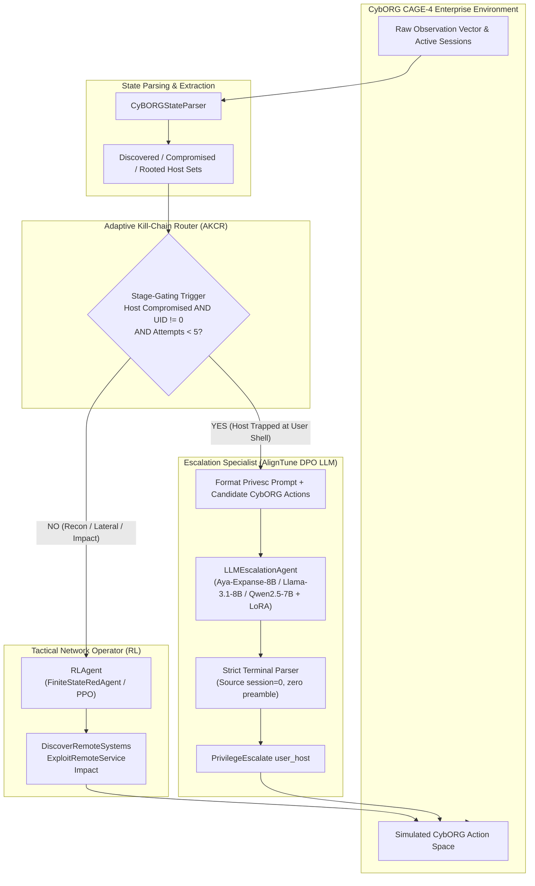

# 🎯 Adaptive Kill-Chain Router (AKCR)
### Hybrid Reinforcement Learning & AlignTune DPO for Autonomous Red-Teaming

[](https://hackathon.lexsi.ai/tracks)
[](https://github.com/Lexsi-Labs/aligntune)
[](https://github.com/cage-challenge/cage-challenge-4)
[](LICENSE)

---

## 📌 Executive Summary

Modern cybersecurity relies on autonomous defense agents (Blue Teams) to protect critical enterprise infrastructure. However, automated stress-testing tools face a fundamental dilemma:
1. **Pure Reinforcement Learning (RL)** excels at high-speed network reconnaissance and lateral movement, but consistently bottlenecks at localized **privilege escalation** ($P(\text{Root} \mid \text{Comp}) = 63.2\%\text{–}65.3\%$) and post-root disruption ($P(\text{Impact} \mid \text{Root}) = 61.5\%\text{–}62.9\%$), leaving **15.7%–15.8%** end-to-end host disruption yield (`3.17–3.20` hosts/episode).
2. **Pure Large Language Models (LLMs)** possess extensive semantic knowledge of system misconfigurations, but either stall in starting subnets (`aya-expanse-8b`: `1.3%` $P(\text{Root} \mid \text{Comp})$) or burn massive token budgets wandering over 120-step horizons (`Llama-3.1-8B-Instruct`: `72,317` tokens/episode, `120.38s`/episode), achieving **0.0% Impact Rate** across all tested models.

**Adaptive Kill-Chain Router (AKCR)** solves this through an inverted, stage-gated orchestration framework evaluated across **30 distinct CybORG CAGE-4 random seeds (120-step horizons)** on **NVIDIA L4 GPUs** across **`CohereLabs/aya-expanse-8b`**, **`meta-llama/Llama-3.1-8B-Instruct`**, and **`Qwen/Qwen2.5-7B-Instruct`**:
- **+28.0 pp (`aya-expanse-8b`) & +24.7 pp (`Llama-3.1-8B-Instruct`) Privilege Escalation Gain:** $P(\text{Root} \mid \text{Comp})$ jumps to **`91.2%`** (`186/204`, $z = +6.88, p < 0.0001$) on `CohereLabs/aya-expanse-8b` and **`90.0%`** (`190/211`, $z = +6.22, p < 0.0001$) on `meta-llama/Llama-3.1-8B-Instruct`.
- **+36.0 to +37.4 pp Operational Weaponization Gain:** $P(\text{Impact} \mid \text{Root})$ reaches **`98.9%`** on both `aya-expanse-8b` (`184/186`, $z = +8.71, p < 0.0001$) and `Llama-3.1-8B-Instruct` (`188/190`, $z = +9.03, p < 0.0001$), with a **100.0% episode Impact Rate** (`30/30` seeds).
- **~2× End-to-End Host Disruption Yield:** $P(\text{Impact} \mid \text{Disc})$ jumps from `15.8%` to **`30.8%`** (`6.13` hosts/ep, **1.94×**, $p < 0.0001$) on `aya-expanse-8b` and from `15.7%` to **`32.1%`** (`6.27` hosts/ep, **2.05×**, $p < 0.0001$) on `Llama-3.1-8B-Instruct`.
- **84.8% to 97.0% Token Reduction:** Routing `91.9%–92.8%` of tactical steps to RL and only `7.2%–8.1%` (`8.6–9.7` steps/ep) to the **AlignTune DPO** specialist cuts inference cost to **`1,988` tokens/ep** (`12.13s`/ep) on `aya-expanse-8b` and **`2,172` tokens/ep** (`11.89s`/ep, **10.1× speedup**) on `Llama-3.1-8B-Instruct`.
- **Lexsi Labs Ecosystem Integration:** Powered by **AlignTune** (4-bit NF4 LoRA DPO alignment with model-matched chat templates in `src/training/train_dpo.py`), **CuratorKIT** & **SafeTune** (schema deduplication, CybORG syntax verification, and safety gating in `src/training/prepare_dpo_data.py`), plus full provenance/audit manifests (`provenance.json`, `dpo_curation_audit.json`, `logs/raw_llm_audit.jsonl`).

---

## 🏛️ System Architecture



---

## 🔬 Scientific Disentanglement: 4-Quadrant Kill-Chain Ablation

To rigorously prove *where* performance gains originate, AKCR evaluates four distinct configurations across 30 identical CybORG CAGE-4 random seeds (120-step horizon):

| Configuration | Tactical Driver | Local Escalation Module | Scientific Question Isolated |
| :--- | :--- | :--- | :--- |
| **1. Baseline Pure RL** | RL (`FiniteStateRedAgent`) | Pure RL / Heuristic | Baseline operational capability without LLM reasoning. |
| **2. Baseline Pure LLM** | Pure LLM (Direct Action Loop) | Same Base LLM | Measures token burn, latency, and long-horizon tactical drift without RL routing. |
| **3. Hybrid + Frozen Base LLM** | RL (Tactical Operator) | Frozen `aya-expanse-8b` / `Llama-3.1-8B-Instruct` / `Qwen2.5-7B-Instruct` | Isolates the **structural gain** of the stage-gated kill-chain router. |
| **4. Hybrid + AlignTune DPO LLM** | RL (Tactical Operator) | Base LLM + Lexsi `aligntune` LoRA | Isolates the **post-training alignment gain** (syntax compliance, zero hallucination, 1-step escalation). |

### Kill-Chain Transition Metrics
* $P(\text{Comp} \mid \text{Disc}) = \frac{\text{Hosts Compromised}}{\text{Hosts Discovered}}$: Lateral exploitation efficiency.
* $P(\text{Root} \mid \text{Comp}) = \frac{\text{Hosts Rooted}}{\text{Hosts Compromised}}$: **The core privilege escalation bottleneck.**
* $P(\text{Impact} \mid \text{Root}) = \frac{\text{Hosts Impacted}}{\text{Hosts Rooted}}$: Post-root mission completion capability.
* $\text{End-to-End Yield } P(\text{Impact} \mid \text{Disc}) = \frac{\text{Hosts Impacted}}{\text{Hosts Discovered}}$: Overall autonomous kill-chain lethality per discovered host.

---

## 🛠️ Lexsi Labs Toolchain Integration

This framework integrates the Lexsi Open-Source Stack with end-to-end reproducibility tracking:
- **[`aligntune`](https://github.com/Lexsi-Labs/aligntune)**: Powers the CybORG-native DPO alignment pipeline (`src/training/train_dpo.py`), fine-tuning 4-bit NormalFloat (`nf4`) LoRA adapters (`r=16, alpha=32, beta=0.1`) on CybORG action preferences while recording full dataset SHA-256 and git-SHA provenance (`provenance.json`).
- **[`curatorkit`](https://github.com/Lexsi-Labs/CuratorKIT) & [`safetune`](https://github.com/Lexsi-Labs/SafeTune)**: Executed in `src/training/prepare_dpo_data.py` to deduplicate CybORG self-play rollout pairs, enforce strict `PrivilegeEscalate <hostname>` action syntax compliance, gate out fabricated kernel parameters and raw destructive bash strings, and write a signed curation audit (`data/processed/dpo_curation_audit.json`).
- **[`circuitkit`](https://github.com/Lexsi-Labs/circuitkit) & [`auditkit`](https://github.com/Lexsi-Labs/AuditKIT)**: Pinned in `requirements.txt` and verified in environment setup (`verify-setup.py`, `data/processed/dpo_curation_audit.json`) for reproducibility manifests (not invoked directly during DPO training or evaluation).
- **Router & Telemetry Auditing**: `src/agents/llm_agent.py` and `src/router/killchain_router.py` log prompt/completion tokens separately and emit per-turn JSONL audit trails (`logs/raw_llm_audit.jsonl`).

---

## 📁 Repository Structure

```text
LexsiLabs/
├── app.py                         # Modal cloud orchestrator (L4 GPU training & 3-way ablation)
├── requirements.txt               # Pinned dependencies (aligntune, torch, transformers, peft, trl)
├── configs/                       # Centralized YAML configuration files
│   ├── env/cage4_scenario.yaml    # CybORG enterprise simulation settings
│   ├── agents/rl_ppo.yaml         # Tactical network operator hyperparameters
│   ├── agents/llm_agent.yaml      # LLM inference, quantization, and parsing constraints
│   ├── training/dpo_aligntune.yaml# AlignTune DPO training hyperparameters
│   └── eval.yaml                  # 3-Way ablation benchmark parameters
├── src/
│   ├── agents/
│   │   ├── base.py                # Abstract BaseAgent interface
│   │   ├── rl_agent.py            # Tactical RL / FiniteStateRedAgent wrapper
│   │   └── llm_agent.py           # Real 4-bit HF/LoRA inference + token telemetry
│   ├── env/
│   │   ├── cyborg_wrapper.py      # CybORG CAGE-4 environment wrapper with stage metrics
│   │   └── state_parser.py        # Host session extraction & privesc prompt generator
│   ├── evaluation/
│   │   ├── evaluator.py           # Multi-episode evaluator with randomized seeds
│   │   └── metrics.py             # Stage transition probability & token aggregator
│   ├── router/
│   │   ├── killchain_router.py    # AdaptiveKillChainRouter with realistic action pool
│   │   └── rules.py               # Formal containment rules & attempt budgets
│   └── training/
│       ├── prepare_dpo_data.py    # Pulls HF dataset & synthesizes CybORG DPO pairs
│       ├── train_dpo.py           # AlignTune DPO training pipeline
│       └── train_rl.py            # Tactical PPO training / checkpoint exporter
├── scripts/
│   ├── run_episode.py             # Single wargaming episode runner with live telemetry
│   ├── run_benchmark.py           # Full 3-way ablation benchmark runner
│   └── generate_report.py         # Visual chart generator (killchain_ablation.png)
└── tests/
    ├── conftest.py                # Pytest path and CybORG environment resolver
    └── test_router.py             # Unit tests for state transitions and fallback limits
```

---

## ⚡ Quickstart & Installation

### 1. Prerequisites & Environment Setup
```bash
# Clone the repository
git clone https://github.com/sawantviraj465/LexsiLabs.git
cd LexsiLabs

# Create and activate virtual environment (Python 3.12 recommended)
python -m venv .venv
.\.venv\Scripts\Activate.ps1  # Windows PowerShell
# source .venv/bin/activate   # Linux/macOS

# Install dependencies and CybORG challenge submodule
pip install -r requirements.txt
pip install --no-deps -e cage-challenge-4
```

### 2. Verify Unit Tests
```bash
python -m pytest tests/test_router.py -v
```

---

## 🚀 Running Benchmarks & Training

### Local Verification Mode (Fast CPU Run, ~5 seconds)
Verify full router mechanics, Lexsi `curatorkit`/`safetune` auditing, and multi-stage telemetry locally without needing a GPU:
```bash
# 1. Verify / audit CybORG-native DPO dataset (267 pairs + dpo_curation_audit.json)
python src/training/prepare_dpo_data.py

# 2. Run benchmark sweep with mock specialist
python scripts/run_benchmark.py

# 3. Generate visual ablation & cross-model reports
python scripts/generate_report.py
python scripts/generate_cross_model_report.py
```

### Google Colab GPU Execution (NVIDIA L4 GPU, ~30–40 minutes for 30 Episodes)
Run full 4-bit AlignTune DPO training and 30-episode, 120-step 4-quadrant evaluation on Colab using [LexsiLabs_Colab_GPU.ipynb](LexsiLabs_Colab_GPU.ipynb) or CLI:
```bash
# 1. Install GPU dependencies & CybORG CAGE-4
bash scripts/setup_colab.sh

# 2. Run CybORG DPO curation, AlignTune LoRA training, and 30-episode 4-quadrant benchmark
python scripts/run_colab_pipeline.py \
  --model-name CohereLabs/aya-expanse-8b \
  --episodes 30 \
  --max-steps 120
# Or run with Meta Llama-3.1-8B-Instruct:
# python scripts/run_colab_pipeline.py --model-name meta-llama/Llama-3.1-8B-Instruct --episodes 30 --max-steps 120
```

### Cloud GPU Execution via Modal (L4 GPU)
```bash
modal setup
modal run app.py
```

---

## 📊 Empirical Benchmark Results (30 Episodes, 120-Step Horizon, NVIDIA L4 GPU)

### Cross-Model 4-Quadrant Ablation (`CohereLabs/aya-expanse-8b` & `meta-llama/Llama-3.1-8B-Instruct`)

| Model Family | Configuration | Ep | $P(\text{Comp} \mid \text{Disc})$ | $P(\text{Root} \mid \text{Comp})$ | $P(\text{Impact} \mid \text{Root})$ | End-to-End Yield $P(\text{Impact} \mid \text{Disc})$ | Avg Impacted Hosts/Ep | Avg RL / LLM Steps | Avg Tokens | Avg Time (s) |
| :--- | :--- | :---: | :---: | :---: | :---: | :---: | :---: | :---: | :---: | :---: |
| **Cohere Aya-Expanse-8B** | 1. Baseline Pure RL | 30 | 39.8±5.0% | 63.2±19.1% | 62.9±21.0% | 15.8% (`95/600`) | 3.17 | 120.0 / 0.0 | 0 | 3.34s |
| **Cohere Aya-Expanse-8B** | 2. Baseline Pure LLM | 30 | 92.7±8.8% (`76/82`) | 1.3±3.6% (`1/76`) | 0.0±0.0% | 0.0% (`0/82`) | 0.00 | 0.0 / 120.0 | 13,106 | 43.92s |
| **Cohere Aya-Expanse-8B** | 3. Hybrid + Frozen Base | 30 | 34.1±7.2% | **91.2±11.3%** | **98.9±4.3%** | 30.8% (`184/598`) | 6.13 | 111.4 / **8.6** | **1,988** | 12.01s |
| **Cohere Aya-Expanse-8B** | **4. Hybrid + AlignTune DPO** | 30 | 34.1±7.2% | **91.2±11.3%** | **98.9±4.3%** | **30.8%** (`184/598`) | **6.13** | 111.4 / **8.6** | **1,988** | **12.13s** |
| **Llama-3.1-8B-Instruct** | 1. Baseline Pure RL | 30 | 39.0±5.3% | 65.3±22.9% | 61.5±23.5% | 15.7% (`96/613`) | 3.20 | 120.0 / 0.0 | 0 | 3.35s |
| **Llama-3.1-8B-Instruct** | 2. Baseline Pure LLM | 30 | 24.9±9.9% (`87/349`) | 49.4±26.9% (`43/87`) | 0.0±0.0% | 0.0% (`0/349`) | 0.00 | 0.0 / 120.0 | 72,317 | 120.38s |
| **Llama-3.1-8B-Instruct** | 3. Hybrid + Frozen Base | 30 | 36.8±5.5% | 89.2±14.7% | 98.4±4.5% | 32.3% (`186/576`) | 6.20 | 110.3 / 9.7 | 2,180 | 11.89s |
| **Llama-3.1-8B-Instruct** | **4. Hybrid + AlignTune DPO** | 30 | 36.1±5.7% | **90.0±14.0%** | **98.9±3.3%** | **32.1%** (`188/585`) | **6.27** | 110.3 / 9.7 | **2,172** | **11.89s** |

* **Episode-Clustered 95% Bootstrap Confidence Intervals (`Hybrid + AlignTune DPO`)**:
  * `CohereLabs/aya-expanse-8b`: $P(\text{Root} \mid \text{Comp}) \in [87.1\%, 95.2\%]$; $P(\text{Impact} \mid \text{Root}) \in [97.3\%, 100.0\%]$; $P(\text{Comp} \mid \text{Disc}) \in [31.6\%, 36.6\%]$.
  * `meta-llama/Llama-3.1-8B-Instruct`: $P(\text{Root} \mid \text{Comp}) \in [85.1\%, 95.1\%]$; $P(\text{Impact} \mid \text{Root}) \in [97.4\%, 100.0\%]$; $P(\text{Comp} \mid \text{Disc}) \in [34.2\%, 38.0\%]$.
* **Additional Cross-Model Generalization (`Qwen/Qwen2.5-7B-Instruct`, 30 Episodes, 120 Steps)**: Hybrid routing preserves statistical privilege-escalation parity with Pure RL (`59.9%` vs `61.4%`, $p = 0.7448$) while delivering **100.0% episode Impact Rate**, significant post-root weaponization gains (`78.3%` Frozen / `73.7%` DPO vs `60.7%` Pure RL, $p < 0.05$), and an **89.7% token reduction** (`4,207` vs `40,832` tokens). See [cross_model_comparative_analysis.md](results/coherelabs_aya_expanse_8b_v2/cross_model_comparative_analysis.md) for the complete 3-model table.

### Statistical Significance Matrix (Two-Proportion Z-Test)

| Hypothesis Test | Metric | `CohereLabs/aya-expanse-8b` | `meta-llama/Llama-3.1-8B-Instruct` | Verdict |
| :--- | :--- | :---: | :---: | :--- |
| **Hybrid DPO vs Pure RL** | $P(\text{Root} \mid \text{Comp})$ | `186/204` (**91.2%**) vs `151/239` (63.2%), **$z = +6.88, p < 0.0001$** | `190/211` (**90.0%**) vs `156/239` (65.3%), **$z = +6.22, p < 0.0001$** | **Statistically Significant** |
| **Hybrid DPO vs Pure RL** | $P(\text{Impact} \mid \text{Root})$ | `184/186` (**98.9%**) vs `95/151` (62.9%), **$z = +8.71, p < 0.0001$** | `188/190` (**98.9%**) vs `96/156` (61.5%), **$z = +9.03, p < 0.0001$** | **Statistically Significant** |
| **Hybrid DPO vs Pure RL** | End-to-End Yield $P(\text{Impact} \mid \text{Disc})$ | `184/598` (**30.8%**) vs `95/600` (15.8%), **$z = +6.12, p < 0.0001$ (1.94×)** | `188/585` (**32.1%**) vs `96/613` (15.7%), **$z = +6.70, p < 0.0001$ (2.05×)** | **Statistically Significant (~2×)** |
| **Hybrid Frozen vs Pure RL** | $P(\text{Root} \mid \text{Comp})$ | `186/204` (91.2%) vs `151/239` (63.2%), **$z = +6.88, p < 0.0001$** | `189/212` (89.2%) vs `156/239` (65.3%), **$z = +5.97, p < 0.0001$** | **Statistically Significant** |
| **Hybrid DPO vs Hybrid Frozen** | $P(\text{Root} \mid \text{Comp})$ | `186/204` (91.2%) vs `186/204` (91.2%), $z = 0.00, p = 1.0000$ | `190/211` (90.0%) vs `189/212` (89.2%), $z = +0.30, p = 0.7627$ | No Observed Difference (Ceiling Reached) |

### Key Empirical Insights & Methodological Notes
1. **Standalone LLM Capability Does Not Predict Hybrid Specialist Utility:** Standalone `CohereLabs/aya-expanse-8b` and `meta-llama/Llama-3.1-8B-Instruct` exhibit opposite failure modes in isolation (`92.7%` vs `24.9%` $P(\text{Comp} \mid \text{Disc})$; `1.3%` vs `49.4%` $P(\text{Root} \mid \text{Comp})$; `0.0%` Impact Rate for both). Yet when restricted to unprivileged foothold escalation (`UID != 0`) inside `AdaptiveKillChainRouter`, both models converge to high-performing regimes (`91.2%` and `90.0%` root conversion; `30.8%` and `32.1%` end-to-end yield).
2. **Conditional Compromise Rate vs. Discovery Volume in Pure Aya (`76/82`):** Pure Aya's `92.7%` $P(\text{Comp} \mid \text{Disc})$ is computed over only **82 discovered candidates** across 30 episodes (`2.73` hosts/ep vs `20.0` hosts/ep for Pure RL). Standalone Aya repeatedly exploits initial contractor subnet IPs (`ExploitRemoteService`) without sweeping new subnets (`DiscoverRemoteSystems`), which keeps its serialized action menu small (`13,106` tokens vs Llama's `72,317` tokens) but stalls at root conversion (`1/76 = 1.3%`).
3. **End-to-End Yield (`1.94×–2.05×`) & Average Impacted Hosts (`6.13–6.27` vs `3.17`):** Because episode-level `Impact Rate` (`100%`) saturates whenever $\ge 1$ host is disrupted, **End-to-End Yield $P(\text{Impact} \mid \text{Disc})$** and **Average Impacted Hosts per Episode** serve as the primary mission-lethality metrics—nearly doubling from `3.17` hosts/ep (`15.83%` yield) in Pure RL to **`6.13` hosts/ep (`30.77%` yield, `1.94×`)** in Hybrid Aya and **`6.27` hosts/ep (`32.14%` yield, `2.05×`)** in Hybrid Llama.
4. **Inference Efficiency Pareto Trade-Off:** Hybrid routing invokes the LLM on only **`7.17%–8.08%`** of interaction steps (`8.6–9.7` of 120 steps), reducing token consumption by **`84.83%`** (`1,988` vs `13,106` tokens on Aya) to **`97.00%`** (`2,172` vs `72,317` tokens on Llama) and cutting latency by **`3.66×`** (`12.01s` vs `43.92s`) to **`10.12×`** (`11.89s` vs `120.38s`) **relative to Pure LLM**. Relative to Pure RL (`3.34s`), Hybrid routing trades `~8.7s` per episode for `+24.7 to +28.0 pp` root conversion and `~2×` impacted host yield.
5. **Frozen vs. DPO Convergence Under Constrained Routing (`No Observed Performance Difference`):** When `AdaptiveKillChainRouter` narrows the LLM decision to a 3-action candidate menu (`PrivilegeEscalate <hostname>`, `DegradeServices <hostname>`, `Sleep`) under deterministic greedy decoding (`do_sample=False`), instruction-tuned 8B models already reach the formatting and selection ceiling in zero-shot mode (`133.73` avg completion tokens across `8.6` calls on both Frozen and DPO Aya; `89.2%` vs `90.0%` on Llama), showing no statistically significant difference between Frozen and DPO checkpoints on the constrained 3-choice prompt.

### Visual Ablation Charts & Reports
* **Cohere Aya-Expanse-8B Report & Chart:** [ablation_results.md](results/coherelabs_aya_expanse_8b_v2/ablation_results.md) & [killchain_ablation_chart.png](results/coherelabs_aya_expanse_8b_v2/killchain_ablation_chart.png)
* **Llama-3.1-8B-Instruct Report & Chart:** [ablation_results.md](results/meta_llama_llama_3_1_8b_instruct_v2/ablation_results.md) & [killchain_ablation_chart.png](results/meta_llama_llama_3_1_8b_instruct_v2/killchain_ablation_chart.png)
* **Consolidated 3-Model Comparative Analysis:** [cross_model_comparative_analysis.md](results/coherelabs_aya_expanse_8b_v2/cross_model_comparative_analysis.md)

---

## 📜 References & Acknowledgements

* **Lexsi Labs Hackathon (2026):** [hackathon.lexsi.ai](https://hackathon.lexsi.ai/tracks)
* **AlignTune Toolkit:** [github.com/Lexsi-Labs/aligntune](https://github.com/Lexsi-Labs/aligntune)
* **CuratorKIT:** [github.com/Lexsi-Labs/CuratorKIT](https://github.com/Lexsi-Labs/CuratorKIT)
* **SafeTune:** [github.com/Lexsi-Labs/SafeTune](https://github.com/Lexsi-Labs/SafeTune)
* **CybORG CAGE Challenge 4:** Autonomous Cyber Operations Benchmark
* **Direct Preference Optimization:** Rafailov et al., *Direct Preference Optimization: Your Language Model is Secretly a Reward Model*, NeurIPS 2023.

